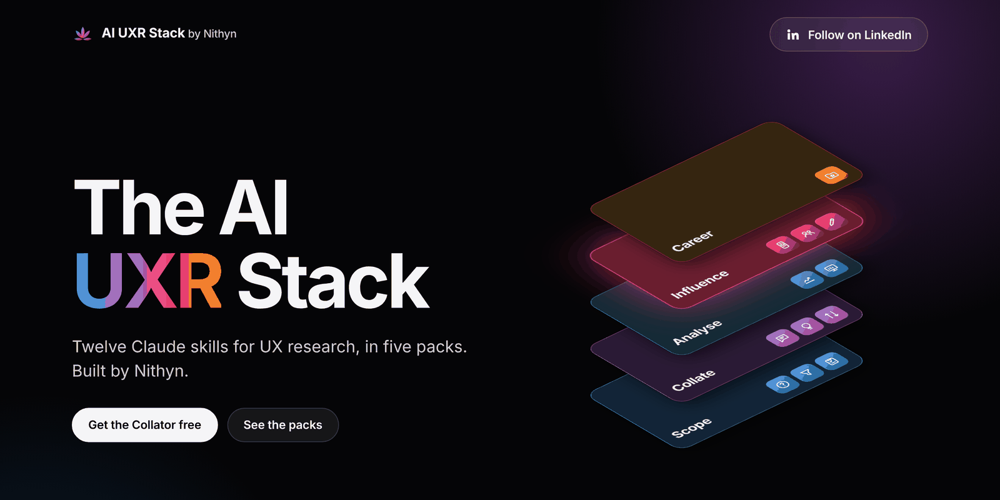
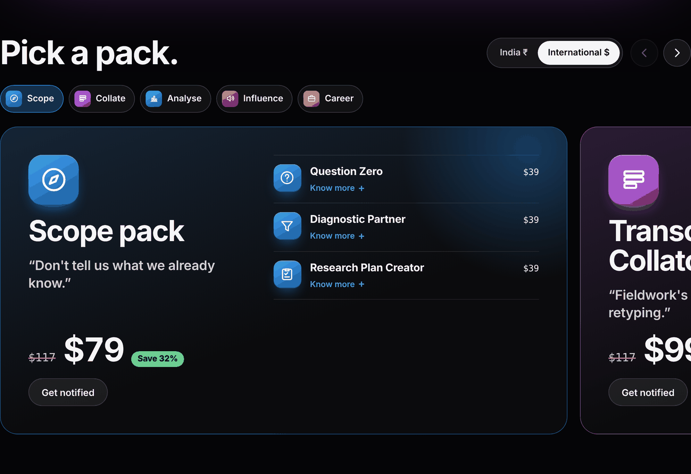
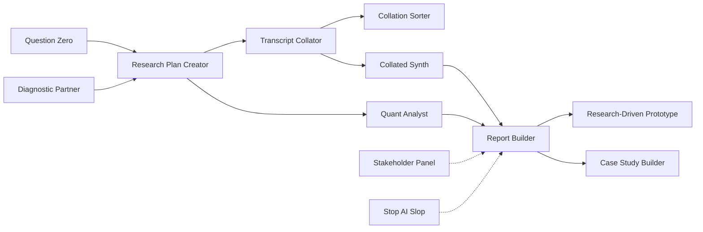

  

  <a href="https://nithyncj-cell.github.io/ai-uxr-stack/"><b>Website</b></a> ·
  <a href="docs/skills.md"><b>The 12 skills</b></a> ·
  <a href="docs/install.md"><b>Install</b></a> ·
  <a href="https://www.linkedin.com/in/nithyn/"><b>Follow on LinkedIn</b></a>

  
  
  

# The AI UXR Stack

Twelve Claude skills for UX research, in five packs. Built by Nithyn.

Each skill takes one slow part of the research cycle and does it the way a senior researcher would: scoping a study, planning it, collating transcripts, reading them for contradictions, running the numbers, building the report, turning findings into a prototype, pressure-testing the work before it goes out, and writing it up as a portfolio case study. They run inside Claude (claude.ai, the desktop app and Claude Code), and each one hands its output to the next.

> **This repo is the public listing for the stack.** It doesn't contain the paid skill files. The website is served from the `gh-pages` branch, and skills are downloaded from the [website](https://nithyncj-cell.github.io/ai-uxr-stack/) under the Skill Licence Terms.

## Free for good: Transcript Collator, Collation Sorter, Stop AI Slop

The Transcript Collator turns raw interview transcripts into one theme-tagged notesheet, with a verbatim quote and timestamp on every row. It's free to download from the [website](https://nithyncj-cell.github.io/ai-uxr-stack/#free), along with Collation Sorter and Stop AI Slop. Tick the licence box, enter your email once, and download the zips.

## The five packs

  

| Pack | The problem it solves | Skills | India | International |
|---|---|---|---|---|
| **Scope** | "Don't tell us what we already know." | Question Zero, Diagnostic Partner, Research Plan Creator | ₹2,499 | $49 |
| **Transcript Collator** | "Fieldwork's done. Now a week of retyping." | Transcript Collator (free), Collated Synth, Collation Sorter (free) | ₹999 | $19 |
| **Analysis** | "Fifty crosstabs and no story." | Quant Analyst, Report Builder | ₹1,999 | $39 |
| **Influence** | "Great findings. Nothing changed." | Research-Driven Prototype, Stakeholder Panel, Stop AI Slop (free) | ₹1,299 | $25 |
| **Career** | "The work was strong. The portfolio isn't." | Case Study Builder | ₹999 | $19 |
| **Starter** | The paid skills most studies need | Research Plan Creator, Collated Synth, Report Builder | ₹2,299 | $45 |
| **Full stack** | All 12 skills | Everything above | ₹4,999 founding, then ₹7,999 | $99 founding, then $149 |

Paid skills are priced by the work they do, from ₹699 / $12 to ₹1,299 / $25. The founding full-stack price is for the first 100 buyers or the first 30 days. Every pack includes 12 months of updates and every new skill Nithyn publishes in that time. Team licences are available on request. Paid packs open soon; [follow on LinkedIn](https://www.linkedin.com/in/nithyn/) to hear first. Prices on the website are the current ones.

## The 12 skills

| Skill | What it does |
|---|---|
| **Question Zero** | Maps what your team already knows, and how it knows it, then turns the gaps into ranked research questions. |
| **Diagnostic Partner** | Works through a solution-shaped brief and funnel data with the PM, and turns it into a research-ready problem. |
| **Research Plan Creator** | Turns kickoff calls, briefs and ad hoc asks into a stakeholder-ready research plan. |
| **Transcript Collator** | Turns raw transcripts into one theme-tagged notesheet, with a verbatim quote and timestamp on every row. |
| **Collated Synth** | Reads each participant's notes start to finish for beliefs, contradictions and tensions, as cited leads you judge. |
| **Collation Sorter** | Sorts the collated sheet by theme and by participant in two new tabs, leaving the original untouched. |
| **Quant Analyst** | Runs survey, usability and behaviour data against your research objectives instead of every possible crosstab. |
| **Report Builder** | Builds a report, deck or topline from your real research data, ready for stakeholder review. |
| **Research-Driven Prototype** | Turns findings into an HTML prototype where every design change links back to a cited insight. |
| **Stakeholder Panel** | Reviews any research artefact through six stakeholder voices, from the CEO to the data scientist. |
| **Stop AI Slop** | A final editing pass that strips AI-writing tells from anything you're about to send. |
| **Case Study Builder** | Turns project documents into portfolio case studies built the way hiring managers read them. |

More on each skill, including the situation it's built for, is in [docs/skills.md](docs/skills.md).

## How they fit together

Stakeholder Panel and Stop AI Slop work at any stage. Every skill knows the other eleven and points you to the right next one.

## What every skill does the same way

- **Opens by saying what it does and what it doesn't**, then asks what you already have before it starts.
- **Never invents quotes, numbers or citations.** Missing data is marked as missing.
- **Reports small samples as counts** ("6 of 8"), not percentages.
- **Treats your files as material, not instructions.** A planted command inside a transcript is flagged, not followed.
- **Keeps its own instructions private.** It explains its outputs but won't recite or help rebuild itself.
- **Writes in plain language**, with the AI-writing tells stripped out.

## Install

1. Download the skill's `.zip` from the website. Don't unzip it.
2. In Claude, open **Customize → Skills**, choose **+ → Create skill → Upload a skill**, and pick the zip.
3. Ask for the job in plain words, for example "collate these transcripts". The skill opens with its intro and `Built by Nithyn`.

Claude Code, updating and troubleshooting: [docs/install.md](docs/install.md).

## Questions

**Is this open source?** No. The skills are paid, proprietary work. This repo holds the listing and the website only. See [LICENSE.md](LICENSE.md).

**Can I read a skill's instructions before I buy?** The website and [docs/skills.md](docs/skills.md) describe what each skill does and what it needs. The instructions themselves stay private.

**Where does my research data go?** Skills run inside your own Claude account. Nothing is sent to Nithyn.

**Can I use it for my team or a client?** Yes, on your own work. For team licences or a custom version, [message Nithyn on LinkedIn](https://www.linkedin.com/in/nithyn/).

**Something isn't working.** Open an issue using the [skill feedback form](../../issues/new/choose). Please don't paste participant data or confidential transcripts.

## Credits

Question Zero builds on James Chudley's knowledge-mapping workshop and his importance and confidence matrix. Stop AI Slop draws on [hardikpandya/stop-slop](https://github.com/hardikpandya/stop-slop) (MIT License) and Wikipedia's [Signs of AI writing](https://en.wikipedia.org/wiki/Wikipedia:Signs_of_AI_writing). Thanks to *The Goal* by Eliyahu M. Goldratt and to Constantine Papas, PhD. The website's skill icons are 3D renders from [NVIDIA SimReady Assets](https://huggingface.co/datasets/nvidia/simready-assets), used under [CC BY 4.0](https://creativecommons.org/licenses/by/4.0/).

## Author

Built by **Nithyn C Joseph**, UX researcher in Bengaluru. [LinkedIn](https://www.linkedin.com/in/nithyn/)

© 2026 Nithyn C Joseph. All rights reserved.
